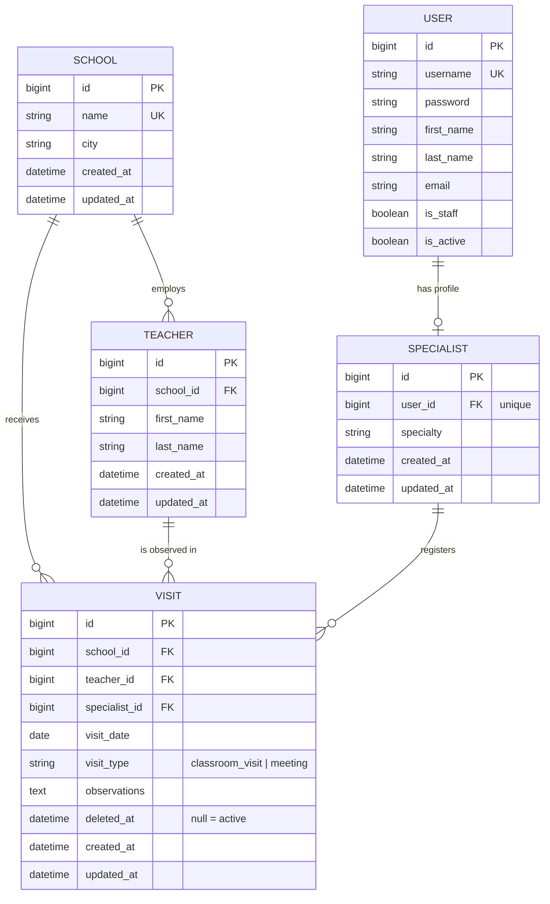
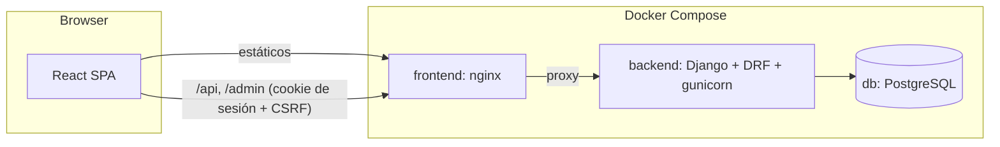

# Registro de visitas a colegios

Aplicación web para que un equipo de especialistas registre y consulte las visitas que realiza a colegios para acompañar a los docentes.
Prueba técnica de Kurios Education (Desarrollador Fullstack).

- **Backend:** Python, Django 5.2 LTS y Django REST Framework.
- **Frontend:** React, Vite, TypeScript y SASS.
- **Base de datos:** PostgreSQL (SQLite como alternativa local).
- **Infraestructura:** Docker Compose.

## Estado del proyecto

El proyecto avanza por fases.

- [x] Fase 0: croquis del monorepo, Docker, documentación y tooling
- [x] Fase 1: modelos del dominio y admin de Django
- [x] Fase 2: seeds
- [ ] Fase 3: autenticación de la API
- [ ] Fase 4: API de visitas
- [ ] Fase 5: fundamentos del frontend (login y rutas)
- [ ] Fase 6: pantallas de visitas
- [ ] Fase 7: cierre y revisión final

Las secciones de este documento que describen funcionalidad futura lo indican expresamente.

## Contenido

- [Estructura del repositorio](#estructura-del-repositorio)
- [Cómo ejecutar el proyecto](#cómo-ejecutar-el-proyecto)
- [Variables de entorno](#variables-de-entorno)
- [Admin de Django](#admin-de-django)
- [Datos iniciales (seeds)](#datos-iniciales-seeds)
- [Modelo de datos](#modelo-de-datos)
- [Arquitectura](#arquitectura)
- [API](#api)
- [Tests y calidad de código](#tests-y-calidad-de-código)
- [Decisiones técnicas](#decisiones-técnicas)
- [Qué quedó fuera y mejoras futuras](#qué-quedó-fuera-y-mejoras-futuras)
- [Uso de inteligencia artificial](#uso-de-inteligencia-artificial)

## Estructura del repositorio

```
.
├── backend/                  API en Django
│   ├── config/               settings, URLs raíz y WSGI
│   ├── apps/
│   │   ├── core/             utilidades compartidas y health check
│   │   ├── accounts/         especialistas y autenticación
│   │   ├── directory/        colegios y docentes
│   │   └── visits/           visitas
│   ├── requirements/         base.txt (producción) y dev.txt (tests y lint)
│   ├── Dockerfile
│   └── entrypoint.sh         migraciones al iniciar el contenedor
├── frontend/                 SPA en React
│   ├── src/
│   │   ├── app/              componente raíz y providers
│   │   ├── api/              cliente HTTP y funciones por endpoint
│   │   ├── features/         una carpeta por funcionalidad
│   │   ├── styles/           variables y estilos globales (SASS)
│   │   └── test/             utilidades de test
│   ├── Dockerfile            build con Node y servidor nginx
│   └── nginx.conf            sirve la SPA y hace proxy de /api, /admin y /static
├── docker-compose.yml
├── CLAUDE.md                 reglas y convenciones del proyecto
└── README.md
```

## Cómo ejecutar el proyecto

### Opción recomendada: Docker

Es la forma más rápida y no requiere instalar Python, Node ni PostgreSQL. Solo necesitas [Docker](https://docs.docker.com/get-docker/) con Docker Compose.

```bash
docker compose up --build
```

| Servicio       | URL                                                    |
| -------------- | ------------------------------------------------------ |
| Aplicación web | http://localhost:3000                                  |
| API            | http://localhost:3000/api/ (o http://localhost:8000/api/) |
| Admin Django   | http://localhost:3000/admin/                           |

Al iniciar, el contenedor del backend aplica las migraciones y carga los [datos iniciales](#datos-iniciales-seeds) (controlado por `SEED_ON_START`), de modo que la aplicación arranca con colegios, docentes, especialistas y visitas de ejemplo.

Comandos útiles:

```bash
docker compose exec backend pytest        # tests del backend
docker compose logs -f backend            # logs del backend
docker compose down                       # detener
docker compose down -v                    # detener y borrar la base de datos
```

Si los puertos 3000 u 8000 están ocupados, cámbialos con `FRONTEND_PORT` y `BACKEND_PORT` (ver [Variables de entorno](#variables-de-entorno)).

### Ejecución local

> Recomendamos usar Docker. La ejecución local es útil para desarrollar con recarga en caliente.

Requisitos: Python 3.12 o superior, Node.js 22 o superior y npm.

**Backend** (en una terminal):

```bash
cd backend
python -m venv .venv
source .venv/bin/activate          # Windows PowerShell: .venv\Scripts\Activate.ps1
pip install -r requirements/dev.txt
cp .env.example .env               # Windows PowerShell: Copy-Item .env.example .env
python manage.py migrate
python manage.py seed_data         # datos iniciales (ver "Datos iniciales")
python manage.py runserver
```

El backend queda en http://localhost:8000. Por defecto usa SQLite (`backend/db.sqlite3`), así que no necesitas PostgreSQL.
Para usar PostgreSQL, descomenta y ajusta `DATABASE_URL` en `backend/.env`.

**Frontend** (en otra terminal):

```bash
cd frontend
npm install
npm run dev
```

El frontend queda en http://localhost:5173. Vite hace proxy de `/api`, `/admin` y `/static` hacia el backend (por defecto `http://localhost:8000`).

## Variables de entorno

**Docker** (`.env` en la raíz; opcional, todas tienen valor por defecto, ver [.env.example](.env.example)):

| Variable                      | Descripción                                   | Por defecto                                 |
| ----------------------------- | --------------------------------------------- | ------------------------------------------- |
| `POSTGRES_DB`                 | Nombre de la base de datos                    | `school_visits`                             |
| `POSTGRES_USER`               | Usuario de la base de datos                   | `school_visits`                             |
| `POSTGRES_PASSWORD`           | Contraseña de la base de datos                | `school_visits`                             |
| `DJANGO_SECRET_KEY`           | Clave secreta de Django                       | clave insegura de demostración              |
| `DJANGO_ALLOWED_HOSTS`        | Hosts permitidos, separados por coma          | `localhost,127.0.0.1,backend`               |
| `DJANGO_CSRF_TRUSTED_ORIGINS` | Orígenes confiables para CSRF                 | `http://localhost:3000,http://localhost:8000` |
| `DJANGO_TIME_ZONE`            | Zona horaria (define qué fecha es "hoy")      | `America/Caracas`                           |
| `SEED_ON_START`               | Cargar datos iniciales al iniciar el backend  | `true`                                      |
| `BACKEND_PORT`                | Puerto publicado del backend                  | `8000`                                      |
| `FRONTEND_PORT`               | Puerto publicado del frontend                 | `3000`                                      |

**Backend local** (`backend/.env`, ver [backend/.env.example](backend/.env.example)):

| Variable                      | Descripción                                          |
| ----------------------------- | ---------------------------------------------------- |
| `DJANGO_DEBUG`                | `True` en desarrollo local                           |
| `DJANGO_SECRET_KEY`           | Obligatoria si `DJANGO_DEBUG` es `False`             |
| `DJANGO_ALLOWED_HOSTS`        | Hosts permitidos                                     |
| `DJANGO_CSRF_TRUSTED_ORIGINS` | Orígenes confiables para CSRF                        |
| `DJANGO_TIME_ZONE`            | Zona horaria (por defecto `America/Caracas`)         |
| `DATABASE_URL`                | `sqlite:///db.sqlite3` o una URL de PostgreSQL       |

**Frontend local** (`frontend/.env`, opcional, ver [frontend/.env.example](frontend/.env.example)): `VITE_API_PROXY_TARGET` indica a qué backend hace proxy el servidor de desarrollo.

## Admin de Django

El admin está en `/admin/` (http://localhost:3000/admin/ con Docker, http://localhost:8000/admin/ en local) y permite gestionar colegios, docentes, especialistas y visitas.

Inicia sesión con el usuario administrador de los [datos iniciales](#datos-iniciales-seeds) (`admin` / `admin12345`) o crea el tuyo:

```bash
python manage.py createsuperuser                              # local (desde backend/)
docker compose exec backend python manage.py createsuperuser  # Docker
```

Para crear un especialista: crea primero el usuario en **Users** y después un registro en **Specialists** que lo enlace.

En el admin, las visitas eliminadas siguen apareciendo (filtro «Deleted at»), y eliminar una visita desde allí también es lógico: se rellena `deleted_at` y la fila se conserva. Para restaurarla, vacía `deleted_at`.

## Datos iniciales (seeds)

La aplicación necesita datos para mostrar algo útil desde el primer arranque. Se cargan con un comando de gestión **idempotente**: se puede ejecutar cuantas veces se quiera y nunca duplica ni pisa datos existentes.

```bash
python manage.py seed_data                               # local (desde backend/)
docker compose exec backend python manage.py seed_data   # Docker
```

- **Con Docker** se ejecuta solo al iniciar el contenedor del backend. Para desactivarlo, define `SEED_ON_START=false`.
- **En local** hay que ejecutarlo a mano después de `migrate`.

**Qué carga:**

| Dato           | Cantidad | Detalle                                                                                       |
| -------------- | -------- | --------------------------------------------------------------------------------------------- |
| Colegios       | 4        | Colegio San Rafael, Unidad Educativa Las Palmas, Colegio Santa Lucía, Unidad Educativa Monte Sinaí |
| Docentes       | 12       | 3 por colegio                                                                                 |
| Especialistas  | 3        | Con usuario para iniciar sesión                                                               |
| Administrador  | 1        | Usuario del admin de Django                                                                   |
| Visitas        | 3        | Una por especialista: 2 visitas en aula y 1 encuentro, de hace 2, 9 y 20 días                 |

Todos los datos son ficticios. Las fechas de las visitas se calculan respecto al día del primer arranque, así que nunca caen en el futuro.

**Usuarios de demostración** (solo para desarrollo; no uses estas credenciales fuera de un entorno local):

| Rol           | Usuario          | Contraseña   | Especialidad   |
| ------------- | ---------------- | ------------ | -------------- |
| Especialista  | `maria.gonzalez` | `demo1234`   | Matemáticas    |
| Especialista  | `carlos.pena`    | `demo1234`   | Lectoescritura |
| Especialista  | `lucia.mendoza`  | `demo1234`   | Ciencias       |
| Administrador | `admin`          | `admin12345` | -              |

**Cómo se comporta al repetirse:**

- Si un registro ya existe, se deja tal cual (por ejemplo, no se restablece una contraseña que hayas cambiado).
- Si eliminas una visita de ejemplo, no se vuelve a crear.
- Todo ocurre en una transacción: si algo falla, no queda nada a medias.

Para volver al estado inicial por completo en Docker: `docker compose down -v` y luego `docker compose up --build`.

El código está en un módulo `seeds.py` por app (`directory`, `accounts` y `visits`) y el comando que los orquesta está en `backend/apps/visits/management/commands/seed_data.py`.

## Modelo de datos

Los nombres de tablas y columnas están en inglés; Django prefija cada tabla con el nombre de su app (por ejemplo `directory_school`).



Reglas:

- Un docente pertenece a un colegio y una visita referencia a ese colegio y a uno de sus docentes. La base de datos no puede expresar esa coherencia, así que la valida `Visit.clean()`.
- `visit_type` solo admite `classroom_visit` (visita en aula) y `meeting` (encuentro). Lo garantiza una restricción `CHECK` en la base de datos.
- `observations` no puede estar vacío (restricción `CHECK`).
- `visit_date` no puede ser futura. Se valida en `Visit.clean()` comparando con la fecha de hoy en la zona horaria `DJANGO_TIME_ZONE`.
- Un docente no puede repetirse (mismo nombre y apellido) dentro de un colegio, y el nombre del colegio es único.
- Los colegios, docentes y especialistas con visitas asociadas no se pueden borrar (`PROTECT`).
- La eliminación de visitas es lógica: se rellena `deleted_at` y la fila se conserva. `Visit.objects` (manager por defecto, también usado en las relaciones como `school.visits`) excluye las eliminadas; `Visit.all_objects` las incluye.
- `USER` es el modelo de autenticación de Django; `SPECIALIST` es el perfil de dominio asociado a cada usuario especialista.

## Arquitectura



- La SPA llama siempre a rutas relativas (`/api/...`). En Docker, nginx hace de proxy hacia el backend; en desarrollo lo hace el servidor de Vite. Al ser el mismo origen, las cookies de sesión y el token CSRF funcionan sin configurar CORS.
- El backend separa responsabilidades por app (`accounts`, `directory`, `visits`), con serializers para validar, vistas delgadas para HTTP y queries en managers/querysets.
- El frontend se organiza por funcionalidad (`features/`), con la capa `api/` como único lugar que conoce el formato de red y TanStack Query para el estado del servidor.

## API

Disponible hoy:

| Método | Ruta           | Descripción                  |
| ------ | -------------- | ---------------------------- |
| GET    | `/api/health/` | Estado del servicio (público) |

El resto de endpoints (autenticación, colegios, docentes y visitas) se documentará aquí al implementarse. La API exigirá sesión en todos los endpoints salvo los explícitamente públicos.

## Tests y calidad de código

**Backend** (desde `backend/`, con el entorno virtual activo):

```bash
pytest                                  # tests
ruff check . && ruff format --check .   # lint y formato
```

Los tests usan SQLite en memoria salvo que se defina `DATABASE_URL` (en Docker corren contra PostgreSQL).

**Frontend** (desde `frontend/`):

```bash
npm test                  # tests (Vitest + Testing Library)
npm run lint              # ESLint
npm run format:check      # Prettier
npm run typecheck         # TypeScript estricto
npm run build             # build de producción
```

## Decisiones técnicas

- **Vite en lugar de Next.js.** Es una SPA que consume una API propia, sin SSR ni SEO. Vite es más simple, rápido y suficiente.
- **TypeScript en modo estricto**, sin `any`, y ESLint + Prettier. Se usa TypeScript 6.0 y no 7.0 porque `typescript-eslint` aún no lo soporta.
- **Django 5.2 LTS.** Versión de soporte extendido, preferible a la última versión no LTS para un proyecto que se va a mantener.
- **PostgreSQL con alternativa SQLite.** Docker usa PostgreSQL; en local, `DATABASE_URL` permite usar SQLite y arrancar sin instalar nada.
- **Autenticación por sesión de Django con CSRF.** No hay tokens en JavaScript, se reutiliza el sistema de usuarios del admin y, al ser same-origin, no requiere CORS.
- **Eliminación lógica con `deleted_at`.** Conserva el historial y permite saber cuándo se eliminó, a diferencia de un booleano.
- **Reglas de negocio en el backend**, validación del cliente solo para respuesta rápida.
- **TanStack Query** para el estado del servidor: caché, carga, errores e invalidación tras mutaciones.
- **SASS con CSS Modules** y variables de diseño centralizadas.
- **Variables de entorno con valores por defecto funcionales**, para que `docker compose up --build` funcione sin configurar nada.

## Qué quedó fuera y mejoras futuras

Se completará al cierre del proyecto. Candidatas, ordenadas por valor:

- Documentación OpenAPI interactiva.
- Integración continua (tests y linters en cada push).
- Permisos finos por especialista.
- Filtro por rango de fechas y búsqueda en observaciones.
- Pruebas end to end.

## Uso de inteligencia artificial

> Borrador de la declaración; se completa con el detalle final al cerrar el desarrollo.

**Herramienta utilizada:** Claude Code (asistente de programación de Anthropic) integrado en VS Code.

**En qué partes me apoyé en ella:**

- Croquis del monorepo: generado con los comandos oficiales (`django-admin startproject`, `startapp` y `create-vite`) y adaptado después con configuración por entorno, Docker, tooling y documentación inicial.
- Escritura de tests y código de las fases siguientes (se detallará por fase).

**Qué tuve que corregir de lo que generó:**

- La primera versión del croquis se escribió a mano en lugar de usar los generadores oficiales; la rehice con `django-admin` y `create-vite`.
- `npm create vite@latest -- --template react-ts` generó en PowerShell un proyecto sin React (el wrapper de npm no pasó bien la plantilla); se resolvió con `npx create-vite@latest frontend --template react-ts --eslint`.
- Se intentó usar TypeScript 7, incompatible con `typescript-eslint`; se fijó la serie 6.0.
- Se eligió Django 5.2 LTS en lugar de la última versión disponible (6.1), por ser LTS.
- Una regla de lint (`RUF012`) producía falsos positivos con las clases de DRF y se desactivó.

**Cómo lo controlé:** todos los commits los hago yo tras revisar cada cambio; los tests, linters y builds se ejecutan antes de confirmar.
